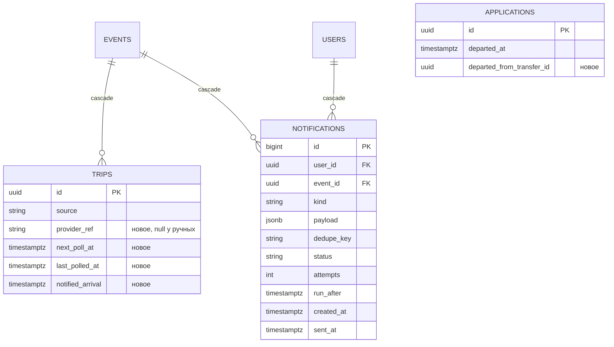
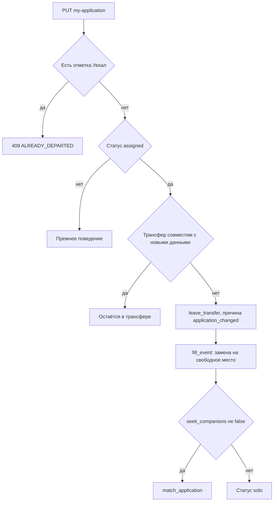
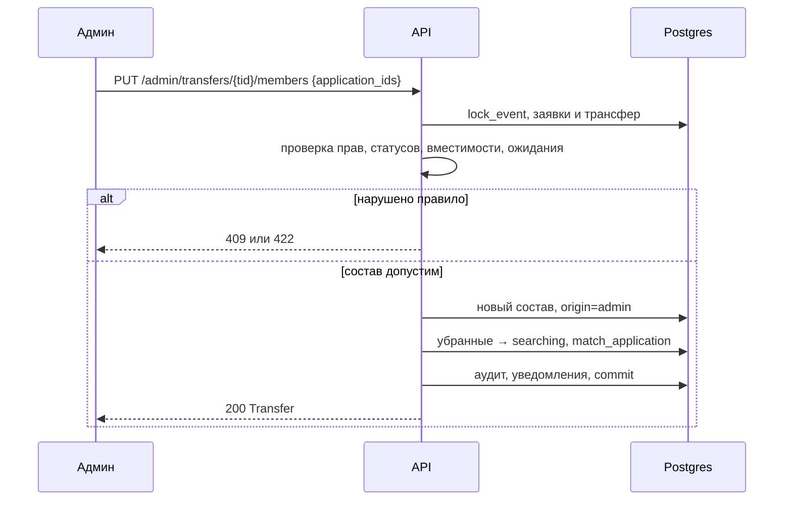
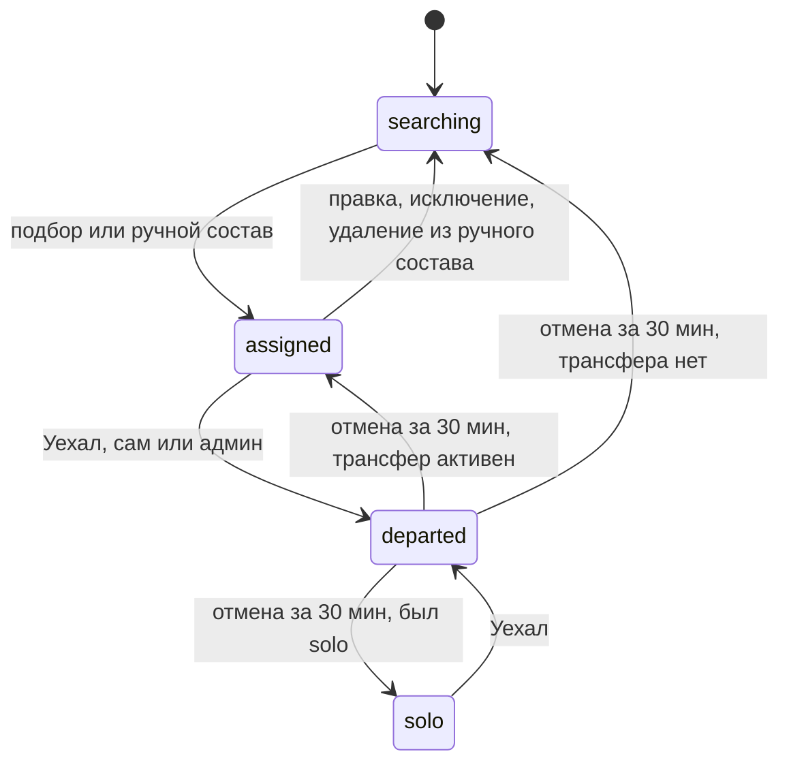
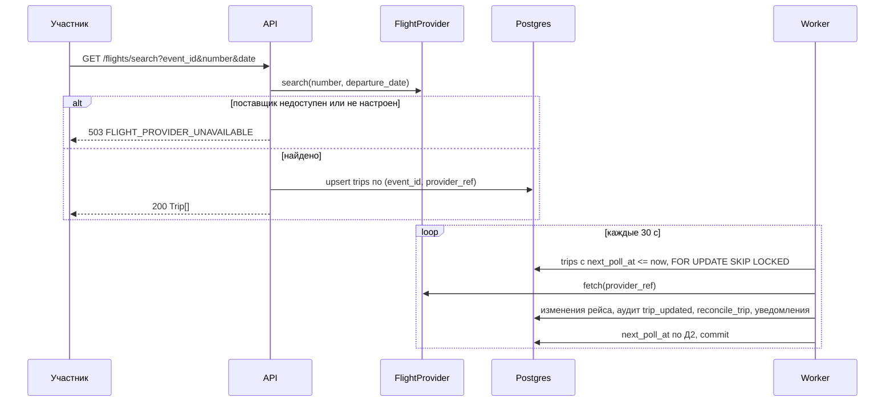
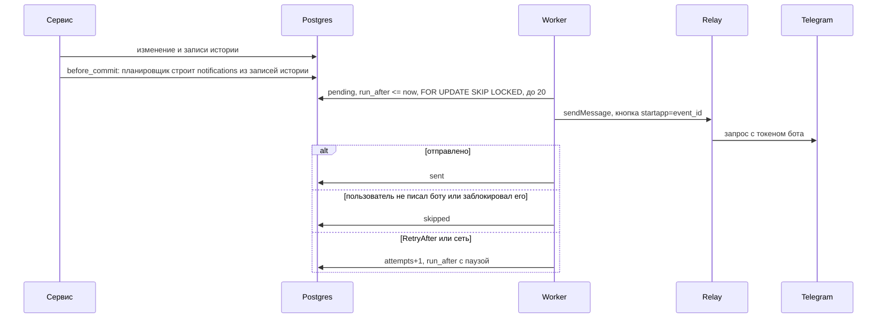
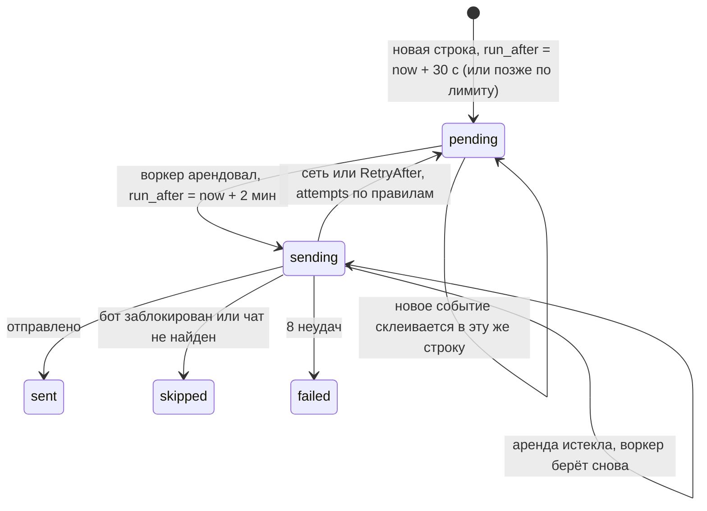
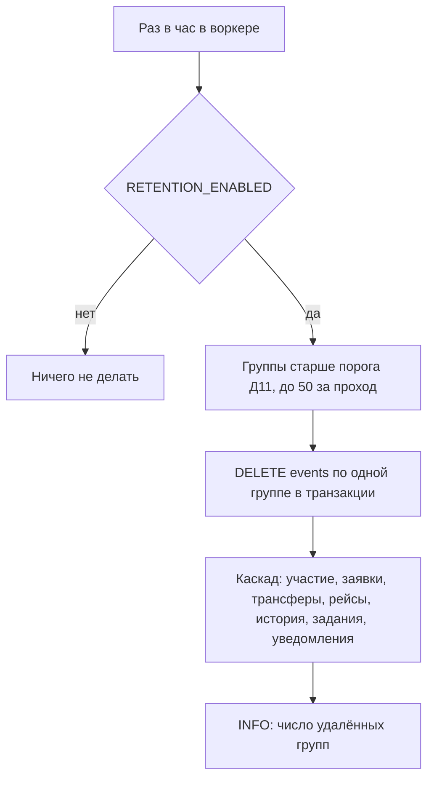
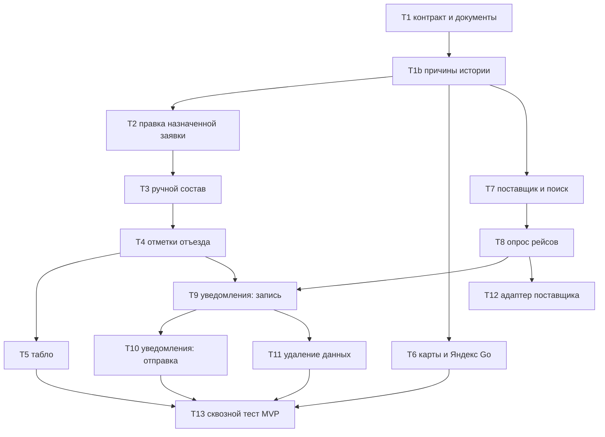

# Спецификация: бэкенд MVP

## Контекст

Запрос от 2026-11-16: доделать на бэкенде возможности MVP из `docs/capabilities.md`, раздел «Этапы разработки»,
колонка «Что добавляем в MVP». Фронтенд делает другая команда. Изменения контракта она получает через
`docs/contracts/openapi.yaml` и перегенерированный `frontend/src/api/schema.d.ts`.

Ветка `feature/mvp` от `main` (e269465, после слияния PR #2 и #3).

## Что уже есть и чего нет

| CAP | Дополнение MVP | Состояние бэкенда | Задача |
| --- | --- | --- | --- |
| 01 | Аватар из Telegram | Есть: `photo_url` из initData сохраняется в профиле | Только тест |
| 02 | Закрытие вступления | Есть: `join_open`, `409 JOIN_CLOSED` | Только тест |
| 02 | Изменение настроек при действующих заявках | Правка точек без последствий | M-04 |
| 02 | Удаление данных через неделю | Нет | M-06 |
| 04 | Правка назначенной заявки | Нет: `409 APPLICATION_LOCKED` | M-02 |
| 05 | Поиск рейса, статусы, обновление | Нет. В `Trip` уже есть `status`, `source`, `estimated_arrival` | M-01 |
| 06 | Изменения рейсов от поставщика | Нет. Пересчёт после правки рейса уже работает | M-01 |
| 06, 11 | Ручной состав трансфера | Нет, эндпоинты описаны в контракте как `mvp` | M-03 |
| 07 | Данные поставщика в поездке | Следует из M-01 | — |
| 08 | Ссылка на карту | Нет. В `Point` уже есть `lat` и `lon` | M-05 |
| 08 | Отметка отъезда админом, исправление «Уехал» | Нет | M-03 |
| 09 | Ссылка на общий чат | Есть: `chat_url`. Кнопки звонка и чата делает фронтенд | — |
| 10 | Кнопка Яндекс Go | Нет: `yandex_go_url` всегда `null` | M-05 |
| 11 | Табло, фильтры, количества | Нет, `GET /admin/board` описан в контракте | M-03 |
| 12 | Уведомления | Нет. Бот ходит в Telegram через relay (`docs/telegram-relay.md`) | M-04 |

## Допущения

В `capabilities.md`, раздел «Требует уточнения», остаются открытые вопросы. Без ответов работа идёт по допущениям
ниже. После реализации они переносятся в таблицу допущений `docs/backend-plan.md`. Каждое закрыто тестом, поэтому
смена правила видна по упавшему тесту.

| № | Вопрос | Допущение |
| --- | --- | --- |
| Д1 | Поставщик рейсов | Не выбран. Строится интерфейс `FlightProvider` и тестовый `FakeFlightProvider`. Адаптер реального поставщика — задача T12 после выбора. Без настроенного поставщика поиск отвечает `503 FLIGHT_PROVIDER_UNAVAILABLE`, ручные рейсы работают |
| Д2 | Интервалы опроса | Сутки и более до вылета — 60 мин; от 6 ч до суток — 30 мин; меньше 6 ч — 10 мин. После вылета пауза до момента «расчётное прибытие минус 30 мин», затем каждые 10 мин. Опрос прекращается при статусе `landed` или `cancelled` либо через 2 ч после расчётного прибытия. Нет расчётного времени — берётся время по расписанию |
| Д3 | Какие рейсы опрашивать | Только рейсы поставщика, на которые ссылается хотя бы одна заявка в статусе `searching`, `assigned` или `solo` без отметки «Уехал» |
| Д4 | Дата в поиске | Дата вылета в часовом поясе аэропорта вылета, как уже записано в контракте |
| Д5 | Правка назначенной заявки | Если трансфер с новыми данными остаётся совместимым и вмещается, заявка остаётся в нём. Иначе заявка выходит, остальные остаются вместе, на свободное место ищется замена, а изменённая заявка снова идёт в подбор |
| Д6 | Ручной состав | В ручной трансфер можно поставить заявки `searching` и `assigned` без отметки «Уехал», минимум две заявки. Правила вместимости и ожидания те же. Ручной трансфер автоматически не дополняется (уже принято). Убранные заявки получают `searching` и снова идут в подбор |
| Д7 | Исправление «Уехал» | Участник отменяет отметку в течение 30 минут. Если прежний трансфер ещё активен, участник возвращается в него. Иначе получает `searching` и идёт в подбор. Позже 30 минут — `409 ALREADY_DEPARTED` |
| Д8 | Отменённый рейс | Пассажиры рейса выходят из трансферов и получают `searching`. Пока рейс в статусе `cancelled`, подбор их пропускает. Участник получает сообщение о смене рейса |
| Д9 | Адресаты уведомлений | Изменение трансфера: участники этого трансфера, включая выбывшего и нового. Изменение точек и инструкции: все участники группы с активной заявкой. Изменение рейса: его пассажиры и их попутчики. Копии администратору нет. Своё действие участнику не сообщается |
| Д10 | Порог по времени прилёта | Сообщение, если расчётное прибытие сдвинулось на 15 минут и больше от последнего сообщённого значения или рейс отменён |
| Д11 | Удаление данных | Группа удаляется через 7 суток после самого позднего из моментов: конец дня `ends_on` (по UTC−12), последняя отметка «Уехал» в группе, создание и последняя правка группы (защита от `ends_on` задним числом). Вместе с группой удаляются участие, заявки, трансферы, рейсы, история, задания и уведомления. Профиль и телефон пользователя остаются. Старый код приглашения отвечает `404 INVITE_NOT_FOUND`, ссылка из уведомления — `404 NOT_FOUND`. Удаление включает флаг `RETENTION_ENABLED`, по умолчанию он выключен |
| Д12 | Правка точек при назначенных трансферах | Трансферы не пересчитываются: точки общие на группу. Участники получают сообщение |
| Д13 | Координаты точек | Администратор передаёт `lat` и `lon` вместе с адресом. Геокодирования адресов нет |

## Изменения контракта (T1)

| Место | Изменение |
| --- | --- |
| `PUT /events/{id}/my-application` | При `assigned` правка применяется по Д5, `409 APPLICATION_LOCKED` больше не возвращается. `409 ALREADY_DEPARTED` после отъезда остаётся |
| `PUT /events/{id}/my-application/marks` | `departed=false` в течение 30 минут после отметки → 200 по Д7; позже → `409 ALREADY_DEPARTED` |
| `Point` | `lat` и `lon` передаются оба или ни одного; `lat` от −90 до 90, `lon` от −180 до 180; иначе `422` |
| `MyTrip` | Новое поле `meeting_map_url: string \| null` (uri). `taxi.yandex_go_url` заполняется, когда у точки посадки и точки назначения есть координаты |
| `GET /flights/search` | Доступ: участник или админ группы; посторонний → `404 NOT_FOUND`, как в README §9. Добавить `401` |
| `POST /admin/transfers`, `PUT .../members` | Перечислить коды `409`: `INCOMPATIBLE_TRANSFER`, `CAPACITY_EXCEEDED`, `ALREADY_DEPARTED`; `422` для чужих и отменённых заявок |
| `README.md` | Разделы про заявку, отметки, уведомления и удаление данных |

Схема API для остальных эндпоинтов MVP (`/admin/board`, `.../departed`, `/admin/transfers`) уже описана и не
меняется. `schema.d.ts` перегенерируется `npm run gen:api`.

## Модель данных

- Миграция `0005` (T1b): новые причины истории `application_changed`, `departure_undone`, `flight_cancelled`,
  `provider_update` в ограничении `audit_reason`. Её делают до волны 1: причины нужны T2, T4 и T8.
- Миграция `0006` (T7): поля `trips`; уникальный индекс `(event_id, provider_ref)` с условием
  `provider_ref IS NOT NULL`; индекс `trips(next_poll_at)`.
- Миграция `0007` (T4): `applications.departed_from_transfer_id`, без FK: трансфер удаляется при распаде.
- Миграция `0008` (T9): таблица `notifications`, уникальный индекс `(user_id, dedupe_key)`, индекс
  `(status, run_after)`.
- `payload` хранит только белый список: идентификаторы, названия, время. Телефонов и имён попутчиков в нём нет:
  текст сообщения собирается при отправке.

## M-02. Правка назначенной заявки (CAP-04, CAP-06)

| Шаг | Вход | Выход | Побочные эффекты и ошибки |
| --- | --- | --- | --- |
| `services/applications.save_application` | `session`, `event_id`, `user`, `ApplicationInput` | `Application` | Под `lock_event`. Аудит `application_updated`. Уведомления по Д9 |
| `matching.fits_transfer` (новая чистая функция) | `candidate: MatchCandidate`, `others: Sequence[MatchCandidate]` | `bool` | Те же `is_compatible` и вместимость, что в подборе |
| `leave_transfer` | `application`, `new_status`, `actor=participant`, `reason=application_changed` | `None` | Распад трансфера, если остался один участник, — как сейчас |

Ручной трансфер (`origin=admin`) обрабатывается так же: несовместимая заявка выходит, замена в него не ищется.

## M-03. Администратор (CAP-06, CAP-08, CAP-11)

| Эндпоинт | Вход | Выход | Ошибки |
| --- | --- | --- | --- |
| `POST /admin/transfers` | `TransferMembersInput { application_ids: uuid[] }`, 2 и больше | `201 Transfer` | `409 INCOMPATIBLE_TRANSFER`, `409 CAPACITY_EXCEEDED`, `409 ALREADY_DEPARTED`; `422` чужая, отменённая или `solo` заявка, меньше двух заявок; `403` участник-не-админ; `404` посторонний |
| `PUT /admin/transfers/{tid}/members` | `TransferMembersInput`, пустой список распускает трансфер | `200 Transfer` | Те же; `409 ALREADY_DEPARTED`, если трансфер уже `departed` |
| `POST /admin/applications/{aid}/departed` | — | `200 Application` | Повтор идемпотентен. Отметка ставится и спутнику |
| `POST /admin/transfers/{tid}/departed` | — | `200 Transfer`, статус `departed` | Повтор идемпотентен |
| `GET /admin/board?trip_status=…` | Фильтр статусов рейса, повторяемый параметр | `Board { counters, trips[{trip, people, application_ids}] }` | `403`, `404`, `422` для неизвестного статуса |
| `PUT /my-application/marks` с `departed=false` | В пределах 30 минут | `200 Application` | Позже — `409 ALREADY_DEPARTED`. Возврат по Д7 через `departed_from_transfer_id` |

Заявку, переставленную из другого трансфера, сначала убирает `leave_transfer`; прежний трансфер дополняется через
`fill_event`. В `counters` люди считаются со спутниками, `cancelled` в `expected` не входит. Всё пишется в аудит от
`actor=admin`.

`departed` на схеме — отметка `departed_at`, а не значение `ApplicationStatus`: статус заявки при отъезде не
меняется (README §5).

## M-01. Поставщик рейсов (CAP-05, CAP-06, CAP-07)

| Элемент | Вход | Выход | Побочные эффекты и ошибки |
| --- | --- | --- | --- |
| `FlightProvider.search` | `number: str` (нормализованный), `departure_date: date` | `list[ProviderFlight]` | `ProviderUnavailableError` при таймауте 10 с, 5xx или ошибке сети |
| `FlightProvider.fetch` | `provider_ref: str` | `ProviderFlight \| None` | То же |
| `ProviderFlight` | — | `provider_ref`, `number`, `departure_iata`, `arrival_iata`, `scheduled_departure`, `scheduled_arrival`, `estimated_arrival \| None`, `status: TripStatus` | Время с часовым поясом |
| `matching`-соседний модуль `polling.next_poll_at` (чистая функция) | `trip`, `now` | `datetime \| None`; `None` — опрос прекращён | Правила Д2 |
| `services/flights.search_flights` | `session`, `event_id`, `user`, `number`, `date` | `list[Trip]` | Аэропорт, которого нет в `locations`, пропускается с WARNING без номера рейса |
| `services/flights.apply_update` | `session`, `trip`, `ProviderFlight` | `bool` — были ли изменения | Без изменений ничего не пишет. Изменились `effective_arrival` или аэропорт — `enqueue_reconcile`. Рейс `cancelled` — Д8 |

Настройки: `FLIGHT_PROVIDER` (`none` по умолчанию, `fake`, позже имя реального адаптера), ключ поставщика —
секрет деплоя. Ручная правка рейса админом остаётся; следующий ответ поставщика её перезаписывает (CAP-05).

## M-04. Уведомления (CAP-02, CAP-12)

| Элемент | Вход | Выход | Побочные эффекты и ошибки |
| --- | --- | --- | --- |
| `services/notifications.plan_notifications` | синхронная `Session` перед commit; записи истории транзакции из `session.info["fellow_audit_pending"]` | `None` | Обработчик `before_commit` (`app/db.py`), пропускает savepoint. Адресаты по текущему состоянию внутри транзакции; `INSERT ... ON CONFLICT (user_id, dedupe_key) DO NOTHING` |
| `services/notifications.notify` | `session`, `user_id`, `event_id`, `kind`, `payload`, `dedupe_key` | `None` | Прямая запись, только для `points_changed`: у правки группы нет записи истории |
| `kind` | — | `transfer_assigned`, `transfer_changed`, `transfer_left`, `points_changed`, `flight_changed`, `flight_cancelled` | Адресаты по Д9, порог по Д10 |
| Отправитель в воркере | Строки `notifications` | Статус `sent`, `skipped` или `failed` | После 8 неудач — `failed`, ERROR-лог. `TelegramRetryAfter` — пауза из ответа. В логе нет телефона, текста сообщения и токена |

Одна транзакция даёт одному пользователю одно сообщение: при нескольких видах берётся самый важный
(`transfer_assigned` > `transfer_left` > `flight_cancelled` > `transfer_changed` > `flight_changed`);
`dedupe_key` — вид и наименьший номер записи истории. Пользователь, который сам действовал в транзакции,
сообщений по ней не получает. База порога Д10 — `trips.notified_arrival`; если пусто, в него сначала
записывается прибытие до первой правки. `flight_cancelled` получают только пассажиры рейса; о пересборке
трансфера попутчики узнают из `transfer_changed`, а пассажир, вышедший из трансфера с причиной
`flight_cancelled`, второго сообщения не получает. `flight_changed` получают пассажиры и попутчики, в
`payload.role` — `passenger` или `mate`. Уехавшим сообщения о составе и точках не отправляются. Доставка
«как минимум один раз»: при падении между отправкой и записью статуса сообщение может уйти повторно. Воркер получает `BOT_TOKEN` и настройки relay в обоих compose.

### M-04a. Защита от потока сообщений (после предрелизной проверки, находка M1)

Проблема: каждое действие даёт новые строки `notifications`, ограничений нет. Участник, который по кругу
отменяет и снова подаёт заявку, шлёт попутчику по два сообщения бота на каждые два запроса; админ правкой
точек — всем участникам. Решение — склейка, задержка и часовой лимит на получателя в группе.

| Правило | Как |
| --- | --- |
| Не больше одной неотправленной строки на человека в группе | Частичный уникальный индекс `(user_id, event_id) WHERE status = 'pending'`. Строка в отправке (`sending`) не мешает новой `pending` |
| Склейка | Новое событие для того же `(user_id, event_id)` при существующей `pending`: тот же вид — обновляется `payload`; другой вид — вид `several_changes` («В поездке «…» несколько изменений. Откройте поездку.»), `payload` только `event_id`. `run_after`, `dedupe_key` и `attempts` строки не меняются |
| Задержка | Новая строка получает `run_after = now() + 30 с`, чтобы частые изменения успели склеиться |
| Часовой лимит | Если за последние 60 минут человеку по этой группе уже ушло (`sent`) или уходит (`sending`) 6 сообщений, новая строка получает `run_after` = момент, когда самое раннее из них выйдет из окна часа. Сообщение не теряется, склейка в него продолжается |
| Гонка двух транзакций | `UPDATE` существующей `pending`; если строки нет — `INSERT ... ON CONFLICT DO NOTHING`; если вставка не прошла (другая транзакция вставила раньше) — `UPDATE` ещё раз |
| Аренда | Воркер берёт `pending` с `run_after <= now` и `sending` с истёкшей арендой, ставит `status = 'sending'`; результат пишет только строке в `sending` |

Миграция `0009`: значение `sending` в `notification_status`, вид `several_changes` в `notification_kind`,
частичный уникальный индекс, индекс `(user_id, event_id, created_at)` для подсчёта лимита. Метрика
`ft_notifications_planned_total{outcome=created|merged|deferred}`.

Итог для получателя: за час по одной группе — не больше 6 сообщений и ещё одно склеенное после окончания
окна; частые изменения в пределах 30 секунд — одно сообщение.

## M-05. Карты и Яндекс Go (CAP-08, CAP-10)

| Элемент | Вход | Выход |
| --- | --- | --- |
| `links.map_url` | `Point` с координатами | URL Яндекс Карт с меткой в точке; `None` без координат |
| `links.yandex_go_url` | Точка посадки (или место сбора, если посадки нет) и точка назначения | URL перехода в Яндекс Go с обеими точками; `None`, если у одной из точек нет координат |

Формат обеих ссылок сверяется с документацией Яндекса при реализации. Ссылки строятся при ответе `GET /my-trip`,
в базе не хранятся.

## M-06. Удаление данных (CAP-02)

| Элемент | Вход | Выход | Побочные эффекты и ошибки |
| --- | --- | --- | --- |
| `services/retention.expired_event_ids` | `session`, `now` | `list[UUID]` | Только чтение |
| `services/retention.purge_event` | `session`, `event_id` | `None` | Удаление необратимо. Триггер аудита допускает каскадное удаление. Ошибка одной группы не останавливает остальные |

## Задачи

| Задача | Содержание | Миграция |
| --- | --- | --- |
| T1 | Контракт, README, `schema.d.ts` | — |
| T1b | Причины истории MVP в `AuditReason` | `0005` |
| T2 | M-02 | — |
| T3 | `POST /admin/transfers`, `PUT .../members` | — |
| T4 | Отметки отъезда админом, отмена «Уехал» за 30 минут | `0007` |
| T5 | `GET /admin/board` | — |
| T6 | M-05, проверка координат | — |
| T7 | `FlightProvider`, `FakeFlightProvider`, `GET /flights/search` | `0006` |
| T8 | Опрос в воркере, `apply_update`, Д8 | — |
| T9 | Таблица `notifications`, `notify()` во всех точках изменений | `0008` |
| T10 | Отправитель в воркере, тексты сообщений, compose | — |
| T11 | M-06 под флагом | — |
| T12 | Адаптер выбранного поставщика | — |
| T13 | API-тест шагов «Проверка MVP», которые относятся к бэкенду, включая аватар и закрытие вступления; `docker compose` со сквозным сценарием | — |

Волны: сначала T1b; T2, T6 и T7 независимы и идут параллельно; затем T3 и T8; затем T4, T5 после T4; затем T9, T10 и T11;
в конце T13. Номера миграций идут в порядке волн: T7 раньше T4. T12 ждёт выбора поставщика и остальные задачи не
блокирует.

Исполнение — как в `CLAUDE.md`: основная сессия пишет контракт и документы, код пишут агенты-исполнители на
Sonnet, у каждого своя тестовая БД `fellow_<задача>_test`. После каждой задачи зелёные `ruff`, `mypy`,
`pytest -q -W error`. Коммит после ревью задачи. В конце — ревью всей ветки и `/agent-skills:ship`:
изменения касаются прода, телефонов и необратимого удаления данных.

## Критерии приёмки

| № | Критерий |
| --- | --- |
| 1 | Правка назначенной заявки без нарушения правил оставляет её в том же трансфере |
| 2 | Несовместимая правка выводит заявку из трансфера; остальные остаются вместе; на свободное место садится подходящая ждущая заявка; изменённая заявка снова в подборе |
| 3 | Админ собирает ручной трансфер из совместимых заявок; каждое нарушение из таблицы M-03 даёт свой код ошибки; посторонний получает 404, участник — 403 |
| 4 | Убранные из ручного состава заявки получают `searching` и идут в подбор; пустой список распускает трансфер; ручной трансфер не дополняется |
| 5 | Отметки отъезда админом идемпотентны, отмечают и спутника; уехавшие не попадают в подбор |
| 6 | Отмена «Уехал» в пределах 30 минут возвращает участника по Д7; позже — 409 |
| 7 | Табло считает людей со спутниками, без отменённых, фильтр `trip_status` работает |
| 8 | `yandex_go_url` и `meeting_map_url` заполнены при координатах и равны `null` без них; неверные координаты — 422 |
| 9 | Поиск через `FakeFlightProvider` сохраняет рейсы с `source=provider`; повторный поиск не создаёт дублей; недоступный или ненастроенный поставщик — 503 |
| 10 | Изменённое расчётное прибытие обновляет рейс, пишет аудит от `system` и ставит пересчёт; ответ без изменений ничего не пишет; интервалы опроса совпадают с Д2 |
| 11 | Каждое событие из Д9 создаёт ровно одно сообщение каждому адресату; повторный опрос без изменений сообщений не создаёт; заблокированный бот даёт `skipped`; в логах нет телефонов, токена и текста сообщения |
| 12 | При `RETENTION_ENABLED=true` группа старше порога удаляется целиком, пользователи остаются, старый код даёт `404 INVITE_NOT_FOUND`; при выключенном флаге ничего не удаляется |
| 13 | `make check` зелёный, `check:api` подтверждает совпадение `schema.d.ts` с контрактом |
| 14 | Сквозной API-тест проходит шаги 1–9 «Проверки MVP» в части бэкенда с тестовым поставщиком и тестовым ботом |

## Что будет при деплое

- Миграции `0005`–`0008` только расширяют ограничение `audit_reason`, добавляют поля и таблицу.
- Пока `FLIGHT_PROVIDER=none`, поиск рейсов отвечает 503, остальное работает.
- Уведомления начинают уходить сразу после деплоя, если у воркера есть настройки relay.
- Удаление данных не включится, пока в окружении нет `RETENTION_ENABLED=true`.

## Вне объёма

- Экраны фронтенда: табло, ручной состав, поиск рейса, кнопки карт, такси, звонка и чата.
- Отмена всей группы администратором и фиксация неявки: в `capabilities.md` ответа нет.
- Разные аэропорты в одной группе: остаётся допущение «подбор только при одинаковом аэропорте прилёта».
- Геокодирование адресов.
